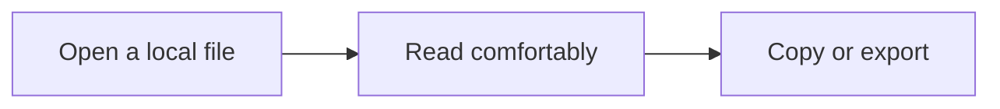

# Welcome to LocalMD

A calm place to read your local Markdown. Every tool is permanently available, and reading needs no network connection.

## Read your way

- Use **Ctrl+O** to open a document, or drop one onto the window.
- Choose **Files** to browse a folder and **Outline** to navigate headings.
- Use **Aa** to adjust the reading font, size, line height, width, and themes.
- Find anything with **Ctrl+F**, including sections further down the document.
- Write in your favorite editor. LocalMD refreshes after saves.

> [!NOTE]
> Your documents remain ordinary files. LocalMD never edits them.

## A diagram



## A useful table

| Stage | Owner | Traffic |
| :--- | :--- | ---: |
| Canary | Search infrastructure | 5% |
| Early regions | Platform | 25% |
| Full rollout | Everyone | 100% |

## Code, ready to copy

```powershell
Get-ChildItem -Filter *.md
```

## A checklist

- [x] Private, offline reading
- [x] Local PDF export
- [x] Optional authenticated loopback API

## Footnotes

Made with open-source components.[^1]

[^1]: Dependency licenses and notices ship with the application.
